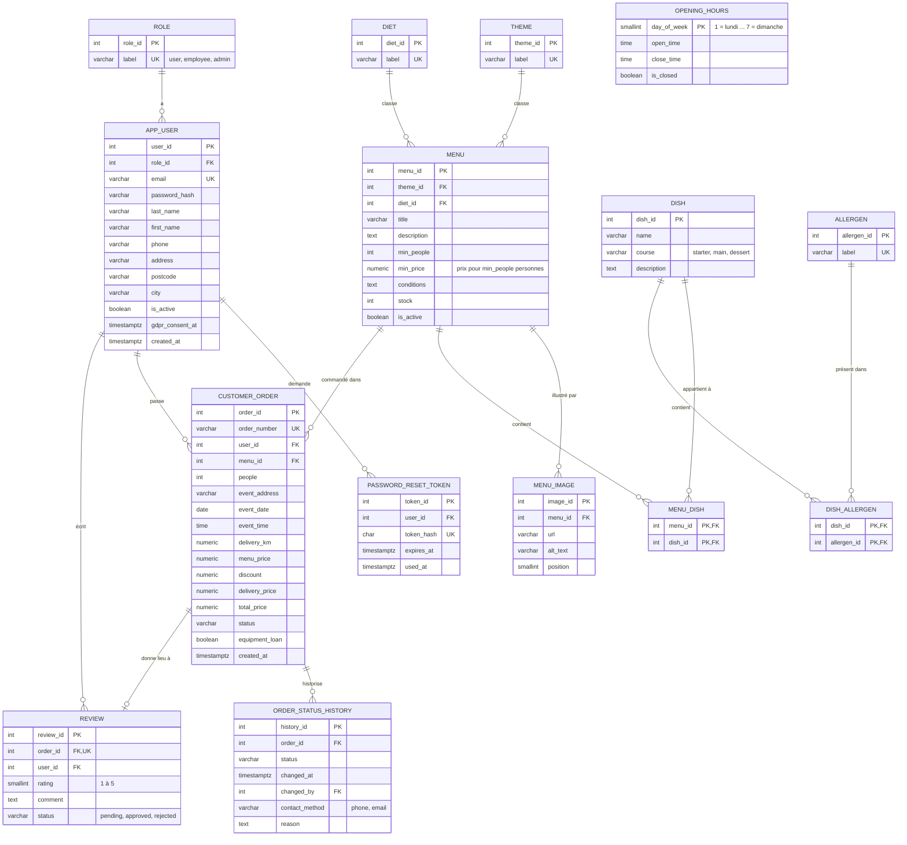

# Modèle de données — Vite & Gourmand

Ce document décrit le modèle relationnel (PostgreSQL) de l'application. Les noms des tables
et des colonnes sont en anglais, comme le reste du code.

MongoDB n'est utilisé que pour les **statistiques de commandes par menu** (voir plus bas).

## Diagramme entité-association



## Règles de gestion

**Utilisateurs et rôles**
- Un utilisateur a un seul rôle : `user`, `employee` ou `admin`.
- Le compte administrateur (José) est créé **uniquement par le script SQL**. Aucune route de l'API ne permet de créer un administrateur.
- Un compte désactivé (`is_active = false`) ne peut plus se connecter, mais il n'est pas supprimé (historique des commandes conservé).
- Le mot de passe n'est jamais stocké en clair : seul son hash (bcrypt) est enregistré.
- Les jetons de réinitialisation de mot de passe sont stockés hashés, avec une date d'expiration, et ne servent qu'une fois (`used_at`).

**Menus et plats**
- Un menu a un thème (Noël, Pâques, Classique, Événement) et un régime (Classique, Végétarien, Vegan).
- `min_price` est le prix du menu pour `min_people` personnes. Prix par personne = `min_price / min_people`.
- Un menu contient plusieurs plats, et un plat peut appartenir à plusieurs menus (relation plusieurs-à-plusieurs `menu_dish`).
- Un plat est une entrée, un plat principal ou un dessert (`course`), et peut contenir plusieurs allergènes (`dish_allergen`).
- `stock` = nombre de commandes encore possibles pour ce menu. Il est décrémenté à chaque commande ; à 0, le menu ne peut plus être commandé.

**Commandes**
- Une commande concerne un seul menu et un seul client.
- Le nombre de personnes est au moins égal au minimum du menu.
- Les prix sont **copiés dans la commande** au moment où elle est passée (`menu_price`, `discount`, `delivery_price`, `total_price`) : un changement de prix du menu ne modifie pas les anciennes commandes.
- Réduction de 10 % si le nombre de personnes ≥ minimum + 5. Livraison gratuite à Bordeaux, sinon 5 € + 0,59 €/km.
- Statuts : `pending` → `accepted` → `preparing` → `delivering` → `delivered` → (`awaiting_equipment_return`) → `completed`, ou `cancelled`.
- Chaque changement de statut crée une ligne dans `order_status_history` avec la date et l'heure. Quand un employé modifie ou annule une commande, il renseigne le mode de contact (`phone` ou `email`) et le motif.
- Le client peut modifier ou annuler sa commande tant qu'elle n'est pas acceptée.

**Avis**
- Un avis ne peut être laissé que sur une commande terminée (`completed`), et un seul avis par commande.
- Note de 1 à 5. L'avis est `pending` à sa création ; seuls les avis `approved` par un employé sont affichés sur la page d'accueil.

**Horaires**
- Une ligne par jour de la semaine (1 = lundi … 7 = dimanche), modifiable par les employés et affichée dans le pied de page.

## Cardinalités

| Relation | Cardinalité |
|---|---|
| Rôle — Utilisateur | 1,1 — 0,n |
| Utilisateur — Commande | 1,1 — 0,n |
| Menu — Commande | 1,1 — 0,n |
| Thème / Régime — Menu | 1,1 — 0,n |
| Menu — Plat | 0,n — 1,n (table `menu_dish`) |
| Plat — Allergène | 0,n — 0,n (table `dish_allergen`) |
| Commande — Historique de statut | 1,1 — 1,n |
| Commande — Avis | 1,1 — 0,1 |

## Données NoSQL (MongoDB)

Collection `menu_stats`, un document par menu, mis à jour à chaque commande :

```json
{
  "menuId": 1,
  "menuTitle": "Menu de Noël",
  "ordersCount": 12,
  "revenue": 2364.50,
  "byDay": [{ "date": "2026-12-01", "orders": 2, "revenue": 360.00 }]
}
```

Elle alimente le graphique de comparaison des commandes par menu et le calcul du chiffre d'affaires de l'espace administrateur, filtrable par menu et par période. Ces lectures fréquentes ne chargent donc pas la base relationnelle.
